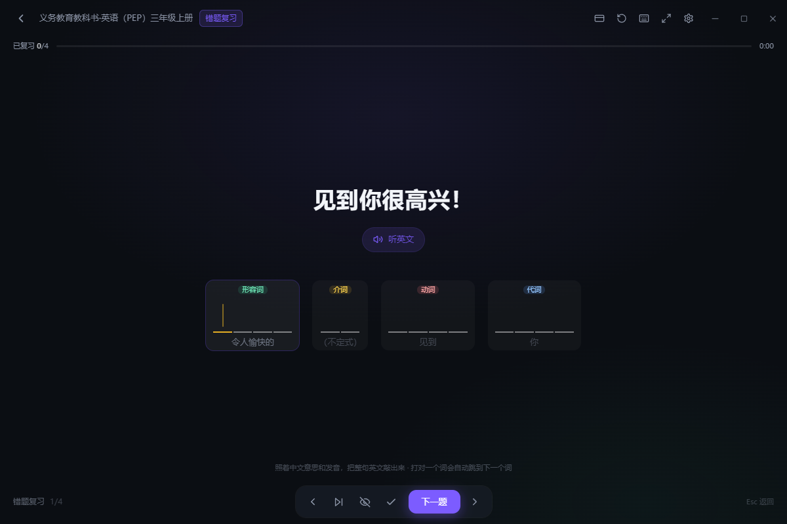

# 小拼手 SpellPal

> 给小学生的英语**整句听写**桌面软件 · 跟教材走 · 一个词一个词敲出来

一个离线的 Windows 桌面软件。孩子选自己的教材和单元，屏幕上给出中文意思、播放英文发音，然后按词把整句英文敲出来——每个词独立成块，块上是词性、块下是这个词的中文。


---

## 它解决什么问题

2022 课标的新教材把小学英语词汇量抬了一大截：人教版 PEP 三年级上册从 64 词涨到 106 词（+66%），每单元要求掌握的词从 12 个变成 20 个。课时没增加，孩子必须在课后用更高效的方式把词记牢、拼对。

背单词软件不少，但大多是给成人考四六级用的——词书自选、释义词典腔（`vt. 满足；遇见；对付`）、输入靠点选。小学生需要的是另一种东西：**跟着今天讲的那一课，把这一课的词放进句子里练到能默写**。

只背单词容易「认得但用不出」。所以这里练的是句子：一句中文，一段英文发音，孩子要把整句英文敲下来。词放在句子里，语序、搭配、单复数这些顺便就练到了。

## 怎么练

点任意单元直接开始，没有模式选择。每一句的界面是这样：

```
              见到你很高兴！                    ← 中文整句
                 [🔊 听英文]                    ← 播放英文整句

   ┌────────┐ ┌──────┐ ┌────────┐ ┌────────┐
   │ 形容词  │ │ 介词  │ │  动词   │ │  代词  │   ← 词性
   │ N I C E│ │ t  o │ │ m e e t│ │ y  o u │   ← 逐字母输入
   │令人愉快的│ │(不定式)│ │  见到  │ │   你   │   ← 这个词的中文
   └────────┘ └──────┘ └────────┘ └────────┘
```

- **打对一个词就自动跳到下一个词**，整句打完自动进下一句，不用按回车。
- 打错不前进，当前词块变红并抖动，改对了才继续。
- `Backspace` 退一格；退到词首再按会回到上一个词。`Space` 放弃当前词。`Enter` 跳过整句。
- 打不出来的句子不用慌，点「听英文」可以无限重播。
- 发音用系统内置语音合成，**完全离线**，不需要下载音频包。

## 错题本 + 间隔重复

打错或跳过的**句子**自动进错题本，按 `1 / 3 / 7 / 16 / 35` 天（Leitner 五级）排队复习，打对升一级、打错掉回第一级。今天该复习几句，书架上直接显示。

一次就全打对的句子**不进**错题本——否则它会变成第二个课表，孩子翻不到重点。已经掌握的可以点对勾手动移出。



## 当前进度

| 模块 | 状态 |
|---|---|
| 书架（切教材 / 选单元 / 错题入口） | ✅ |
| 句子逐词跟打（逐字母判定、自动跳词、词性 + 逐词中文） | ✅ |
| 句子级错题本 + 间隔重复 | ✅ |
| 单元结果页（一次打对率、用时、错句清单） | ✅ |
| 进度持久化（单元正确率、连续天数、上次练到哪） | ✅ |
| 教材数据 | ✅ 人教 PEP 三上 / 三下 / 四上，共 336 词 / 144 句 |
| 四下 – 六下 | 📋 词表来源已找到，待补（见下方「教材版本对照」） |
| 1–2 年级启蒙路径（一年级起点教材：字母 / CVC / 主题词） | 📋 已设计，未开发 |
| 虚拟键盘指法 | 📋 规划中 |

## 已收录教材

| 册次 | 词数 | 句数 | 单元数 | 版本 |
|---|---|---|---|---|
| 三年级上册 | 106 | 48 | 6 | 2024 秋 · 新课标修订版 |
| 三年级下册 | 120 | 48 | 6 | 2025 春 · 新课标修订版 |
| 四年级上册 | 110 | 48 | 6 | 2025 秋 · 新课标修订版 |

单元主题：三上用教材官方英文标题（Making friends / Different families…）；三下与四上用内容概括的中文标题（教材官方标题各渠道说法不一，不硬编）。

### 教材版本对照（为什么是这三册）

人教 PEP 三年级起点从 2024 年秋季开始按 2022 课标改版，一年出两册，截至目前公开可核对的进度是：

| 册次 | 新版启用 | 本项目 |
|---|---|---|
| 三上 | 2024 秋 | ✅ 已收录 |
| 三下 | 2025 春 | ✅ 已收录 |
| 四上 | 2025 秋 | ✅ 已收录 |
| 四下 | 2026 春 | 词表已获取，待补 |
| 五上 | 2025 秋（部分渠道标注 2026 秋） | 词表已获取，待补 |
| 六上 | 2026 秋 | 词表已获取，待补 |
| 五下 / 六下 | 尚未出 | — |

旧版（2012 课标）三上只有 64 词，新版 106 词，两套不能混用——这也是本项目不用网上流传的旧词库的原因。

## 下载与安装

两种形态，任选其一：

| 形态 | 文件 | 说明 |
|---|---|---|
| 安装版 | `SpellPal-x.y.z-setup.exe` | 装到本机，开始菜单和桌面有图标 |
| 免安装版 | `SpellPal-x.y.z-portable.exe` | 双击即用，不写注册表，可放 U 盘 |

到 [Releases](../../releases) 页面下载。系统要求：Windows 10/11 x64。

> **首次运行提示**：安装包未做代码签名（个人项目没有付费证书），Windows SmartScreen 可能提示「已保护你的电脑」。点「更多信息 → 仍要运行」即可。杀毒软件误报同理。

## 本地开发

```bash
git clone https://github.com/huangmoling/spellpal.git
cd spellpal
npm install

npm run dev            # 只跑网页版（浏览器 localhost:5173）
npm run electron:dev   # 跑桌面版（Electron 窗口 + 热更新）
npm run build          # 类型检查 + 打包前端
npm run electron:build # 出安装包 + 免安装包到 release/
```

### 数据构建

词表和例句都以 TSV 为源，脚本校验后生成 JSON：

```bash
npm run books          # = node scripts/build-books.mjs
```

**词表**：`scripts/data/pep-3a.tsv` 等，格式 `unit|word|ipaUK|cnShort|cnFull|syllables`
校验：音节拼接是否等于原词、音标是否为空、释义是否为空、有无词典式标记（`vt.` 之类）、释义是否超过 12 字。

**例句**：`scripts/data/sentences-pep-3a.tsv` 等，TAB 分隔五列
`unit ⇥ 中文整句 ⇥ 英文句子 ⇥ 词性1|词性2… ⇥ 中文1|中文2…`
校验：词性段数、中文段数都必须等于英文按空格切出来的词数；英文里不许出现中文标点；每个单元至少要有一句。

任一条不过就报错退出，不给半成品。

加一本新教材：`scripts/data/` 放两个 TSV → `build-books.mjs` 的 `BOOKS` 加元信息 → `src/data/books/index.ts` import 一行。

## 数据来源与引用

教材是版权作品，所以这里只做两件事：**核对版本**，以及**自己按单元词汇造句**。下面是查证过程中实际用到的公开资料：

| 用途 | 来源 |
|---|---|
| 教材原书（核对册次、单元划分、词表） | [TapXWorld/ChinaTextbook](https://github.com/TapXWorld/ChinaTextbook) → `小学/英语/人教版（PEP）（三年级起点）（主编：吴欣）` |
| 三上 / 三下 / 四上 逐词表（含英美音标） | [qwerty-learner issue #1044](https://github.com/RealKai42/qwerty-learner/issues/1044) 的三个 JSON 附件（`PEP.2024.json` ×2、`PEP.2025.json`） |
| 1–6 年级分单元词表（一年级起点，用于 1–2 年级启蒙规划） | [billyjr/pep-english-vocabulary](https://github.com/billyjr/pep-english-vocabulary)（MIT，`public/data/pep_english_vocabulary_full.csv`，901 行） |
| 四下 2026 春、六上 2026 秋 词表 | 英语朗读宝（`yyld.51jiaoxi.com`）、二一教育（`zy.21cnjy.com`）公开的单元词汇表页面 |

说明两点：

- `billyjr/pep-english-vocabulary` 的 README 写的是 PEP，但实际内容是**人教版一年级起点**（Unit 主题为 School / Face / Animals / Colours 那一套），不是三年级起点 PEP。本项目把它当作 1–2 年级启蒙阶段的参考，没有混进 PEP 三起的词库。
- **例句不是教材课文原文**。每个单元的 8 句是按该单元词汇表和主题自己写的短句，覆盖当单元核心词，语法控制在小学范围。这样既避开了课文版权，也能保证每个词都在句子里出现过。

## 数据说明

- **词表**：人民教育出版社《义务教育教科书·英语（PEP）》2024 课标修订版各册单元词汇表。
- **释义**：按小学语境重写为简短义项（如 `meet` → 「见面」而非「vt. 满足；遇见；对付」）。
- **音标**：英式音标。
- **例句**：本项目自编，非教材原文。
- **音频**：运行时由系统 TTS 合成，未使用任何出版社录音。
- **不含**：课文原文、课文插图、配套听力材料、练习册内容。

本项目与人民教育出版社**无任何关联**，是非官方的个人学习工具。词表仅用于家庭学习，不作商业用途。如权利要求方认为不妥，请联系删除。

## 技术栈

Electron 33 · React 18 · TypeScript 5 · Vite 6 · Tailwind CSS 3 · Zustand

- 判定核心 `src/core/typing.ts`：纯函数，撇号连字符自动跳过，词性配色也在这里
- 状态机 `src/store/useApp.ts`：Zustand，句子队列 + 逐词推进 + 整句裁定
- 界面 `src/components/SentenceBoard.tsx`：按句宽自适应字号，词块三态（已完成 / 当前 / 待打）
- 错题本 `src/utils/srs.ts`：localStorage，Leitner 五级，按句子记
- 发音 `src/utils/speech.ts`：Web Speech API，离线

### 自动化验证

```bash
npx electron scripts/verify.cjs   # 模拟真实键盘事件打完整个单元，14 项断言
```

覆盖：进入练习、队列按句组织、打错不前进、自动跳词、整册打完进结果页、全对不进错题本、错句写入错题本、错题本可进入复习。

## 许可证

代码以 [MIT](LICENSE) 发布。词库数据的使用范围见上文「数据说明」。
